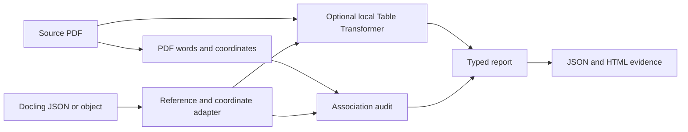

# Architecture

TableProof audits an extraction against source evidence. It does not replace the extractor.

## Stack

| Layer | Choice | Reason |
| --- | --- | --- |
| Runtime | Python 3.11 or later | Integrates with document AI pipelines. |
| PDF words | pdfplumber and pdfminer.six | Reads digital text with source coordinates. |
| PDF images | pypdfium2 through pdfplumber | Renders local evidence images. |
| Models | Pydantic v2 | Defines typed inputs and reports. |
| Optional AI | PyTorch, Transformers, and Table Transformer | Supplies independent row and column detections. |
| CLI | argparse | Keeps the default installation small. |
| Reports | Escaped HTML and JSON | Needs no web service or account. |
| Tests | pytest and Hypothesis | Covers examples and invariants. |
| Static analysis | Ruff and mypy | Finds style and type defects. |
| Distribution | Hatchling | Makes a wheel and source archive. |

## Source adapter

The PDF reader extracts words from each digital page. It uses a top-left origin and PDF points.

The Docling adapter accepts JSON or Pydantic objects. It converts bottom-left coordinates and accounts for declared page dimensions.

A rich cell can refer to a text group. The adapter resolves that group before the audit.

A missing or cyclic reference makes the table uncertain. A table with several source pages is outside the MVP scope.

The adapter does not import Docling. This avoids an extraction model dependency in the default installation.

## Geometry audit

The auditor assigns source words to cell boxes. Partial or competing assignments produce an uncertain finding.

Within each cell, the auditor compares token multisets. It preserves signs and decimal punctuation. It does not compare only document-level token counts.

Separate checks compare logical row and column order with source positions. These checks can detect changed offsets even when cell text remains correct.

Grid checks detect overlapping spans and invalid bounds. Blank cells and repeated values have dedicated control cases.

Source geometry is evidence with limits. Incorrect coordinates and unreadable PDF text can prevent a useful decision.

## Optional model

The model sees a source image crop. It predicts rows, columns, and header regions.

The comparator relates those regions to extracted cells. It returns uncertain findings when the region count or geometry is ambiguous.

The model runs only when the user selects the vision path. The [vision guide](VISION.md) records its revision and measured behavior.

## Report boundary

Each report records the source hash and engine version. Each finding records its method, table, page, and cell when available.

HTML export escapes document text. It embeds local page images and uses no scripts or remote assets.

Before image export, the writer compares the PDF hash with the audit hash. A different source cannot supply the report images.

## Cost and limits

The default audit reads each PDF once. Pairwise cell checks can cost quadratic time within a large table.

The MVP favors evidence quality over large batch throughput. Measure memory and runtime before deployment on large documents.

The library does not execute PDF attachments or call external document URLs. It processes local paths supplied by the caller.
